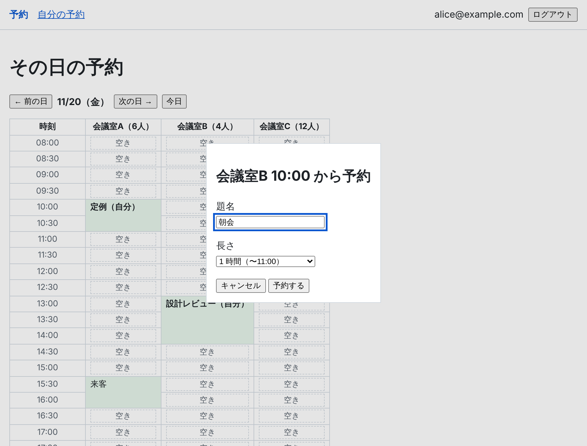

# room-booking — 会議室の予約

社内の会議室を、Web の画面から予約するアプリです。空いている枠を押して題名と長さを選べば予約でき、ほかの人の予約は、画面を読み直さなくても表に出ます。前の日の夕方には、翌日の予約をメールで知らせます。

Node.js の教材の第13部（総合演習）で、要件定義 → 設計 → 実装 → テスト → 公開の順に作りました。



## できること

| だれが         | できること                                                                                       |
| -------------- | ------------------------------------------------------------------------------------------------ |
| ログインした人 | その日の予約を、会議室 × 30 分の表で見る。空いている枠から予約する（30 分〜3 時間、60 日先まで） |
|                | 自分のこれからの予約を一覧し、取り消す                                                           |
|                | ほかの人の予約・取り消しが、すぐに表に出る（SSE）                                                |
|                | 前の日の 18:00 に、翌日の予約のメールを受け取る。管理者に取り消されたら、メールで知る            |
| 管理者         | 会議室を足す・名前と定員を変える・止める                                                         |
| だれでも       | 登録（メールアドレスの確認つき）・ログイン・パスワードの再設定                                   |

予約の決まり（R1〜R10）は [docs/requirements.md](docs/requirements.md) にあります。重なる予約は、2人が同時に押しても片方しか入りません（PostgreSQL の EXCLUDE 制約）。

## 技術

| 部分       | 使ったもの                                                                               | 選んだ理由                         |
| ---------- | ---------------------------------------------------------------------------------------- | ---------------------------------- |
| API        | Node.js 24（TypeScript を型の除去で実行）・Express 5・Zod                                | [ADR 0001](docs/adr/0001-stack.md) |
| 画面       | React 19・TanStack Query・React Router・Vite                                             | 同上                               |
| データ     | PostgreSQL 18（`btree_gist` の EXCLUDE 制約）・Redis 8（仕事の列と、台をまたぐ知らせ）   | 同上                               |
| 後ろの仕事 | BullMQ（メール・前日のリマインド）                                                       | 同上                               |
| テスト     | `node:test`（API 90 個）・Vitest + Testing Library（画面 24 個）・Playwright（E2E 2 個） | [docs/plan.md](docs/plan.md)       |
| 公開       | Docker（4段階の Dockerfile）・Render（`render.yaml`）・GitHub Actions                    | [docs/runbook.md](docs/runbook.md) |

## 設計の資料

| 資料                                         | 中身                                                   |
| -------------------------------------------- | ------------------------------------------------------ |
| [docs/requirements.md](docs/requirements.md) | 要件定義（目的・ユーザーストーリー・決まり R1〜R10）   |
| [docs/screens.md](docs/screens.md)           | 画面の設計                                             |
| [docs/api.md](docs/api.md)                   | API の設計                                             |
| [docs/data.md](docs/data.md)                 | データの設計（表・制約・索引）                         |
| [docs/adr/](docs/adr/)                       | 設計の決定の記録                                       |
| [docs/plan.md](docs/plan.md)                 | 作る順番                                               |
| [docs/runbook.md](docs/runbook.md)           | 運用の手順（デプロイ・戻す・管理者を足す・困ったとき） |
| [docs/retro.md](docs/retro.md)               | 振り返り                                               |

## 動かし方

必要なもの: Node.js 24（`mise.toml`）、Docker。

```sh
$ docker compose up -d --wait   # PostgreSQL（5434）と Redis（6381）
$ npm ci
$ npm run check                 # tsc → ESLint → Prettier → テスト
$ (cd web && npm ci && npm run check)
$ npx playwright install chromium   # 初めてのときだけ
$ npm run e2e                   # 画面から通すテスト（Chromium）
```

開発のサーバは、3つのターミナルで動かします。

```sh
$ npm run mail                  # 偽の SMTP サーバ（1025）。届いたメールは http://127.0.0.1:8025/api/messages
$ npm run dev                   # API（http://127.0.0.1:9900）。ワーカーも中で動く
$ (cd web && npm run dev)       # 画面（http://localhost:5174）
```

最初の管理者は、画面から登録した後で `npm run grant-admin -- alice@example.com` で決めます。

### 本番と同じ形で動かす

API と画面・ワーカー・PostgreSQL・Redis・偽の SMTP サーバを、全部コンテナで動かします。

```sh
$ docker compose -f compose.prod.yaml up -d --build --wait   # http://127.0.0.1:9913
$ docker compose -f compose.prod.yaml exec app node scripts/grant-admin.ts alice@example.com
$ docker compose -f compose.prod.yaml down
```

| ポート     | 使うもの                                          |
| ---------- | ------------------------------------------------- |
| 9900       | 開発の API                                        |
| 5174       | 開発の画面（Vite）                                |
| 5434・6381 | `compose.yaml` の PostgreSQL・Redis               |
| 1025・8025 | 偽の SMTP サーバ                                  |
| 9906〜9908 | E2E                                               |
| 9911・9913 | `compose.prod.yaml` のメール（HTTP）と、API・画面 |
| テスト     | 空いているポート（`freePort`）                    |

## ファイル

| ファイル・フォルダ                                                                                                                       | 中身                                                            |
| ---------------------------------------------------------------------------------------------------------------------------------------- | --------------------------------------------------------------- |
| [src/](src/)                                                                                                                             | API のコード                                                    |
| [migrations/](migrations/)                                                                                                               | マイグレーションの SQL                                          |
| [scripts/](scripts/)                                                                                                                     | 手で動かす道具（管理者を決める・デプロイの後で版を待つ）        |
| [test/](test/)                                                                                                                           | API のテスト                                                    |
| [e2e/](e2e/)                                                                                                                             | 画面から通すテスト                                              |
| [web/](web/)                                                                                                                             | 画面                                                            |
| [docs/](docs/)                                                                                                                           | 要件・設計・運用・振り返り                                      |
| [Dockerfile](Dockerfile)・[.dockerignore](.dockerignore)                                                                                 | イメージ（API・画面・ワーカーを1つに）                          |
| [compose.yaml](compose.yaml)                                                                                                             | 開発とテストの PostgreSQL・Redis                                |
| [compose.prod.yaml](compose.prod.yaml)                                                                                                   | 本番と同じ形を、手元のコンテナで                                |
| [render.yaml](render.yaml)                                                                                                               | Render の Blueprint（Web Service・Worker・Key Value・Postgres） |
| [.github/](.github/)                                                                                                                     | CI・デプロイのワークフローと Dependabot                         |
| [playwright.config.ts](playwright.config.ts)                                                                                             | E2E の設定                                                      |
| [.env.example](.env.example)                                                                                                             | 設定の例（`cp .env.example .env`）                              |
| [package.json](package.json)・[tsconfig.json](tsconfig.json)・[eslint.config.js](eslint.config.js)・[.prettierrc.json](.prettierrc.json) | パッケージ・TypeScript・ESLint・Prettier の設定                 |
| [mise.toml](mise.toml)                                                                                                                   | Node.js のバージョン                                            |

## 作った順番

| 章     | 足したもの                                                                                                                                   | テスト（足した数）             |
| ------ | -------------------------------------------------------------------------------------------------------------------------------------------- | ------------------------------ |
| 土台   | 第12部のタスク管理アプリから、どの題材でも使う部分（ログイン・メール・仕事の列・設定・監視）だけを残したもの                                 | API 25・画面 14・E2E 1         |
| 第67章 | 要件と設計（`docs/`）、予約の決まりの純粋な関数（`src/domain/`）、会議室と予約の表（`migrations/002`）                                       | 単体 26・制約 6                |
| 第68章 | 役割（member・admin）と `grant-admin`、会議室と予約のリポジトリ・サービス・ルート                                                            | 単体 4・リポジトリ 4・HTTP 17  |
| 第69章 | 画面（その日の表・予約のダイアログ・自分の予約・会議室の管理）、SSE の知らせ、管理者の取り消しのメール、前日のリマインド（`migrations/004`） | 単体 4・HTTP 4・画面 10・E2E 1 |
| 第70章 | Dockerfile・`compose.prod.yaml`・`render.yaml`・CI とデプロイのワークフロー、この README、運用の手順、振り返り                               | （テストは足していない）       |

GitHub Actions と Render では、執筆の環境から動かしていません。YAML として読めることと、各コマンドが手元で通ることだけを確かめました。
